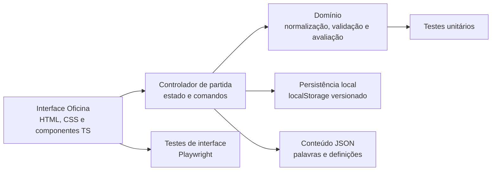

# Especificação Técnica: PegaPalavras

**Versão:** 0.1  
**Data:** 2026-10-20  
**Status:** proposta técnica baseada no PRD e no protótipo Oficina

## 1. Objetivo

Este documento descreve uma implementação viável para o MVP de PegaPalavras com a direção visual **Oficina**: blocos tipográficos, cores vivas, bordas definidas e uma hierarquia simples para crianças de 6 a 8 anos. O jogo será um site responsivo, em português brasileiro, sem conta, anúncios ou dados pessoais de jogador.

O PRD continua sendo a fonte de requisitos do produto: [docs/plans/2026-10-20-pega-palavras.md](docs/plans/2026-10-20-pega-palavras.md). Este documento define uma proposta de organização e implementação; não altera as decisões de produto ainda pendentes.

## 2. Premissas e limites

- A única implementação existente é o protótipo estático [prototipos.html](prototipos.html); ainda não há framework, build, testes ou backend estabelecidos.
- A proposta abaixo usa TypeScript e Vite em uma aplicação de página única, sem framework de interface. A escolha mantém pequena a aplicação e facilita testar a lógica de palavras sem depender do DOM.
- O MVP pode ser hospedado como conteúdo estático e usar dados locais versionados. Autenticação, sincronização, placares, histórico e arquivo ficam fora do escopo.
- O desafio diário não é competitivo. Em uma aplicação estática, os dados da lista de palavras podem ser inspecionados no navegador; impedir isso exigiria serviço remoto e não é requisito atual.
- Uma palavra diária e seus textos devem ser revisados por uma pessoa antes da publicação. Não gerar palavras ou definições automaticamente em produção.

## 3. Decisões técnicas propostas

| Área | Proposta para o MVP |
| --- | --- |
| Interface | HTML semântico, CSS e TypeScript com Vite |
| Execução | Navegador moderno, mobile-first, sem instalação |
| Estado temporário | Estado em memória durante a partida |
| Persistência | `localStorage` versionado para continuar uma partida após recarregar |
| Dados de conteúdo | Arquivos JSON locais, revisados e validados no build |
| Desafio diário | Chave de data calculada no fuso `America/Sao_Paulo` |
| Acesso | Sem conta, APIs de terceiros de analytics ou dados de perfil |
| Testes | Vitest para domínio e Playwright para fluxos no navegador |
| Hospedagem | Qualquer host de arquivos estáticos com HTTPS e cache de assets versionados |

### Trade-off sobre a palavra secreta

Em uma aplicação estática sem backend, uma pessoa tecnicamente curiosa pode inspecionar o código ou os dados publicados para encontrar a resposta. Ocultar a resposta apenas no DOM não a protege. Para o MVP casual, aceitar esse trade-off mantém o produto simples e sem coleta de dados. Se impedir esse tipo de consulta virar requisito, reavaliar a arquitetura; entregar feedback a um navegador sem revelar informação suficiente ao jogador não pode ser garantido só pelo CSS ou por ofuscação do JavaScript.

## 4. Arquitetura

Separar a aplicação em três responsabilidades: apresentação acessível, regras puras do jogo e conteúdo editorial. A lógica de avaliar letras deve ser independente da interface, para que os mesmos testes cubram tabuleiro e teclado virtual.



### 4.1 Estrutura de arquivos sugerida

```text
pegaPalavras/
  index.html
  package.json
  tsconfig.json
  vite.config.ts
  src/
    main.ts
    app/
      game-controller.ts
      game-state.ts
      storage.ts
      daily-date.ts
    domain/
      evaluate-guess.ts
      normalize-word.ts
      validate-guess.ts
      types.ts
    ui/
      render-game.ts
      render-board.ts
      render-keyboard.ts
      render-learning-card.ts
      bind-events.ts
    styles/
      tokens.css
      base.css
      game.css
      responsive.css
    content/
      answers.json
      guesses.json
      content.schema.json
  tests/
    unit/
      evaluate-guess.test.ts
      normalize-word.test.ts
      daily-date.test.ts
      storage.test.ts
    e2e/
      daily-game.spec.ts
      practice-game.spec.ts
```

Manter `prototipos.html` como artefato de exploração visual até a nova tela Oficina ser implementada e aceita. Não importar o JavaScript de demonstração diretamente para a versão real: ele contém resposta fixa, palpites ilustrativos e não implementa validação de dicionário nem persistência.

## 5. Modelo de domínio

### 5.1 Tipos principais

```ts
export type GameMode = "daily" | "unlimited" | "practice";
export type GameStatus = "playing" | "won" | "lost";
export type LetterStatus = "correct" | "present" | "absent";

export interface Puzzle {
  id: string;
  date?: string;
  answer: string;
  definition: string;
  example: string;
  difficulty: "easy" | "medium";
}

export interface GuessResult {
  word: string;
  letters: LetterStatus[];
}

export interface GameState {
  schemaVersion: 1;
  mode: GameMode;
  puzzleId: string;
  dateKey: string;
  guesses: GuessResult[];
  currentDraft: string;
  status: GameStatus;
  updatedAt: string;
}
```

`Puzzle.answer` é conteúdo de domínio, não deve ser exibido até o resultado. As estatísticas globais e o estado de sequência não fazem parte deste modelo, pois não entram no MVP.

### 5.2 Dados editoriais

Manter respostas e palpites válidos em listas diferentes. A resposta diária precisa ser uma palavra adequada e familiar para a faixa etária; a lista de palpites pode ser maior, mas não deve aceitar nomes próprios, abreviações ou termos que o produto não pretende ensinar.

Exemplo ilustrativo, a ser validado editorialmente:

```json
{
  "id": "2026-10-20",
  "date": "2026-10-20",
  "answer": "PANDA",
  "definition": "Mamífero que se alimenta principalmente de bambu.",
  "example": "O panda comeu um pedaço de bambu.",
  "difficulty": "easy"
}
```

O pipeline de build deve falhar quando houver resposta fora do comprimento esperado, identificador repetido, campos obrigatórios ausentes, definição vazia ou entrada duplicada após normalização. Registrar a fonte e a licença de cada base lexical usada; não copiar listas de jogos comerciais.

## 6. Regras do jogo

### 6.1 Comprimento e caracteres

- Cada resposta e palpite válido possui cinco letras, contando letras percebidas pelo jogador, não bytes UTF-8.
- Normalizar texto para Unicode NFC antes de segmentar. Usar `Intl.Segmenter("pt-BR", { granularity: "grapheme" })` quando disponível para contar letras; fornecer fallback compatível com navegadores suportados.
- Ignorar diferenças entre vogais acentuadas para comparar letras, conforme decisão do PRD: `A`, `Á`, `À`, `Â` e `Ã` comparam como `A`; equivalentes para `E`, `I`, `O` e `U`.
- Preservar `Ç` como letra distinta de `C`. Não remover indiscriminadamente todos os sinais combinantes: isso colapsaria o cedilha.
- Exibir a grafia editorial correta na definição e no exemplo. A regra para aceitar palpites digitados sem acento ainda é uma decisão pendente; centralizar essa política em `normalize-word.ts` para alterá-la sem reescrever a avaliação.
- Converter para maiúsculas usando locale `pt-BR`; aparar espaços externos. Não aceitar espaços internos, pontuação ou caracteres fora do alfabeto definido.

### 6.2 Avaliação de letras e repetição

Implementar a avaliação em duas passagens, sempre depois da normalização:

1. Comparar cada posição. Letras iguais na mesma posição recebem `correct` e são consumidas da resposta.
2. Para posições restantes, procurar a letra entre as ocorrências da resposta ainda não consumidas. Se existir, marcar `present` e consumir uma ocorrência; caso contrário, marcar `absent`.

Essa ordem impede que uma letra repetida seja marcada como presente mais vezes do que ocorre na resposta. A função deve ser pura: recebe palpite e resposta e retorna cinco estados, sem atualizar a interface ou persistência.

Exemplos obrigatórios de teste:

- Resposta `PANDA`, palpite `MANGA`: `M` ausente, `A` correta, `N` correta, `G` ausente, `A` correta.
- Resposta `PAPEL`, palpite `PALMA`: o segundo `A` é ausente, pois a resposta só contém um `A`; `L` aparece em outra posição.
- Resposta com acento: validar equivalência das vogais sem remover o cedilha de `Ç`.

### 6.3 Validação e encerramento

- Não consumir tentativa para palpite com tamanho incorreto ou palavra inválida.
- Ao aceitar palpite válido, registrar resultado e incrementar a contagem.
- Encerrar como vitória quando as cinco letras normalizadas forem iguais à resposta.
- Encerrar como derrota após seis palpites válidos sem acerto.
- Exibir resposta, definição e exemplo tanto na vitória quanto na derrota.
- Desabilitar novas letras e envio após encerramento; permitir uma nova partida onde o modo escolhido autorizar.
- Dicas são um controle configurável, mas sua penalidade ainda está pendente no PRD. Não inventar desconto ou consumo de tentativa na implementação; bloquear a entrega funcional da dica até que o comportamento e o texto de confirmação sejam definidos.

## 7. Desafio diário e modos

### 7.1 Chave diária

Gerar uma chave `YYYY-MM-DD` usando `Intl.DateTimeFormat` com `timeZone: "America/Sao_Paulo"`, `year`, `month` e `day`. Não usar apenas `new Date().toISOString()` para definir o dia do desafio, pois isso representa UTC e pode divergir do horário brasileiro.

```ts
export function getBrazilDateKey(now = new Date()): string {
  const parts = new Intl.DateTimeFormat("en-CA", {
    timeZone: "America/Sao_Paulo",
    year: "numeric",
    month: "2-digit",
    day: "2-digit"
  }).formatToParts(now);

  const value = Object.fromEntries(parts.map(part => [part.type, part.value]));
  return `${value.year}-${value.month}-${value.day}`;
}
```

Os testes devem cobrir instantes antes e depois de 00:00 em São Paulo, incluindo datas em que o fuso do dispositivo não é o brasileiro. A aplicação deve ter exatamente uma resposta para cada data publicada. Se não houver conteúdo para a data calculada, apresentar uma mensagem de indisponibilidade, sem escolher uma palavra aleatória diferente por dispositivo.

### 7.2 Comportamento dos modos

- **Diário:** uma partida por `dateKey`; todos usam o mesmo `puzzleId` naquela data.
- **Ilimitado:** inicia partidas não competitivas com respostas selecionadas do banco local; não altera o desafio diário.
- **Prática:** usa o mesmo motor de jogo, sem placar e sem punição competitiva.
- O modo ativo deve permanecer visível no cabeçalho da partida.
- Não permitir que mudar de modo sobrescreva silenciosamente uma partida em andamento. Até decisão de produto, solicitar confirmação antes de descartar um rascunho ou manter a partida salva separadamente por modo.

## 8. Persistência local

Usar uma chave namespaced e versionada, por exemplo `pegapalavras:game:v1`. Persistir apenas o essencial para retomar a partida: modo, identificador do desafio, data, palpites válidos, rascunho atual, estado e instante de atualização. Não persistir nome, idade, e-mail ou identificador de criança.

Regras de recuperação:

- Validar o JSON carregado e a versão do schema antes de usar.
- Ignorar conteúdo corrompido com fallback para uma partida nova e mensagem simples; nunca interromper a tela por erro de storage.
- Salvar após palpite válido e após alteração significativa do rascunho, com debounce se necessário.
- Uma partida diária iniciada antes da virada continua associada ao `puzzleId` original até terminar. A partida seguinte usa a nova data.
- Mostrar os limites de persistência: dados ficam apenas no mesmo navegador/perfil e podem ser apagados pelo usuário.
- Usar `try/catch` para navegadores em modo privado ou storage indisponível; manter o estado em memória enquanto a aba estiver aberta.

## 9. Interface Oficina

### 9.1 Tokens visuais

Usar tokens CSS, evitando cores avulsas espalhadas pelos componentes. Paleta derivada do protótipo Oficina:

| Token | Valor | Uso |
| --- | --- | --- |
| `--color-paper` | `#F1F5FB` | Fundo de página |
| `--color-surface` | `#FFFFFF` | Tabuleiro e superfícies principais |
| `--color-ink` | `#1D2A43` | Texto principal |
| `--color-muted` | `#52647D` | Texto secundário |
| `--color-blue` | `#214E9A` | Ação principal, marca e foco |
| `--color-coral` | `#E94F37` | Acentos e feedback de atenção |
| `--color-yellow` | `#FFC857` | Destaques não essenciais |
| `--color-mint` | `#72C7B3` | Acentos e ilustração |
| `--status-correct` | `#BDE9D0` | Letra no lugar |
| `--status-present` | `#FFE091` | Letra em outra posição |
| `--status-absent` | `#D5DDEA` | Letra ausente |

`Baloo 2` é a fonte de títulos e letras do tabuleiro; `Lexend` é a fonte de instruções e controles. Produção deve empacotar fontes locais com licença compatível ou usar fallback legível, em vez de depender de chamadas obrigatórias a terceiros.

### 9.2 Componentes

- `GameHeader`: marca, data do desafio e rótulo do modo ativo.
- `ModeSelector`: controles Diário, Ilimitado e Prática; não iniciar outra partida sem preservar ou confirmar descarte da atual.
- `GameInstructions`: regra em uma frase curta e tentativas restantes.
- `GuessBoard`: seis linhas por cinco letras, resposta acessível em texto e estado de cada letra.
- `OnScreenKeyboard`: letras, enviar e apagar; suporta mouse, toque e foco/ativação por teclado.
- `HintControl`: descrição do efeito antes da confirmação, após definição da regra.
- `LearningResult`: resposta, definição e exemplo após término.
- `LiveAnnouncement`: uma região de anúncio concisa para erro, palpite aceito e encerramento; não reler o tabuleiro inteiro a cada mudança.

### 9.3 Layout responsivo

- Desktop: área de jogo central com tabuleiro/teclado e coluna de instruções/dica. O tabuleiro deve ser o primeiro foco visual da página; sem hero promocional.
- Mobile: uma coluna; controles de modo acima do tabuleiro, teclado logo abaixo e instruções após a área de jogo. Nenhum conteúdo essencial deve depender de hover.
- Manter cinco colunas estáveis no tabuleiro; em telas estreitas reduzir lacunas e tamanho de casas dentro de limites legíveis, nunca comprimir letras ou criar rolagem horizontal.
- Teclas e ações importantes devem ter alvos confortáveis (mínimo recomendado de 44 × 44 CSS px quando o espaço permitir) e separação visual.
- Não escalar tipografia com largura de viewport. Quebrar textos e permitir redimensionamento do navegador sem sobreposição.

## 10. Acessibilidade e interação

- Preferir HTML semântico e controles nativos. Não usar `role="grid"` sem implementar também a navegação por setas esperada para uma grade interativa; uma lista estruturada de tentativas pode ser mais simples para esse tabuleiro de leitura.
- Associar a cada letra um estado textual: “posição correta”, “aparece em outra posição” ou “não aparece”. Cor, forma e símbolo podem reforçar o estado, nunca ser o único canal.
- Expor rótulos claros para teclas e comandos (“Enviar palpite”, “Apagar última letra”). O estado da letra deve constar no nome acessível das teclas usadas.
- Manter indicação de foco visível e com contraste. Ao clicar numa letra virtual, preservar um caminho claro para continuar digitando pelo teclado físico.
- Tratar teclas de letras, Backspace e Enter sem interferir em atalhos do navegador ou na ativação de botões focados. Evitar listeners globais que submetam duas vezes quando Enter ativa um botão nativo.
- Anunciar erros sem consumir tentativa, atualização de resultado e tentativas restantes por `aria-live="polite"`; manter anúncios curtos.
- Não usar cor como único feedback, não usar som obrigatório, evitar flashes e respeitar `prefers-reduced-motion`.
- Oferecer instruções em frases curtas e manter definição/exemplo legíveis com ampliação de texto.
- Testar teclado físico, leitor de tela, modo de alto contraste, movimento reduzido, escala de texto e viewport mobile. Revisão automatizada não substitui teste manual.

## 11. Erros e estados de interface

| Estado | Comportamento esperado |
| --- | --- |
| Palpite incompleto | Informar que são necessárias cinco letras; não consumir tentativa |
| Palavra não aceita | Explicar que a palavra não está na lista; não consumir tentativa |
| Salvamento indisponível | Manter a partida em memória e continuar jogável |
| Conteúdo diário ausente | Informar indisponibilidade; não sortear outro desafio silenciosamente |
| Vitória | Anunciar acerto, revelar conteúdo educativo e impedir novo envio |
| Seis tentativas sem acerto | Revelar resposta, definição e exemplo sem linguagem punitiva |
| Troca de modo com jogo ativo | Preservar rascunho ou pedir confirmação antes de descartá-lo |

Não usar mensagens de culpa ou pressão, nem exibir sequência diária no MVP.

## 12. Qualidade e testes

### 12.1 Testes unitários (Vitest)

- Normalização de maiúsculas, espaços, Unicode NFC, vogais acentuadas e `Ç`.
- Comprimento por grafema, incluindo entrada em Unicode decomposto.
- Avaliação de letra correta, presente e ausente.
- Letras repetidas em resposta e palpite; nenhuma ocorrência pode ser contabilizada duas vezes.
- Validação contra respostas e palpites permitidos.
- Transições `playing` → `won` / `lost`; seis tentativas e bloqueio após término.
- Chave diária em instantes adjacentes à meia-noite de São Paulo.
- Leitura, escrita, versão inválida e indisponibilidade de `localStorage`.

### 12.2 Testes de navegador (Playwright)

- Iniciar desafio diário, inserir palavra pelo teclado físico, corrigir com Backspace e enviar.
- Repetir o fluxo com teclado virtual e toque.
- Verificar rejeição de palavra sem gastar tentativa.
- Confirmar feedback visual e rótulos acessíveis para os três estados.
- Ganhar e perder partidas; confirmar definição e exemplo em ambos os resultados.
- Trocar modo e preservar/confirmar a partida ativa conforme decisão implementada.
- Recarregar a página e retomar a partida diária sem trocar a resposta.
- Validar 1280 × 900 e 390 × 844 sem sobreposição nem rolagem horizontal.
- Fazer verificação manual com teclado e leitor de tela em pelo menos um navegador suportado.

### 12.3 Critérios de aceite da implementação

- Todos os testes unitários passam e os fluxos críticos de navegador estão cobertos.
- Uma criança consegue explicar como inserir e enviar um palpite após as instruções iniciais, em teste acompanhado por responsável.
- Os estados das letras podem ser entendidos sem distinguir cores.
- Definição e frase foram revisadas para correção, clareza e adequação à idade.
- O jogo continua funcionando sem conta e sem rede após carregar os assets essenciais; conteúdo e fonte local não dependem de terceiros em tempo de execução.
- Não há erros de console nos fluxos de vitória, derrota, troca de modo ou recuperação da partida.

## 13. Build, execução e publicação

Scripts esperados em `package.json`:

```json
{
  "scripts": {
    "dev": "vite",
    "build": "tsc -b && vite build",
    "preview": "vite preview",
    "test": "vitest run",
    "test:e2e": "playwright test"
  }
}
```

O deploy é estático: servir o diretório `dist/` via HTTPS, habilitar compressão e cache de longa duração para assets com hash, mas revalidar o HTML e os dados do desafio diário. Não é necessário instalar cookies, analytics ou cadastro. Se telemetria de aprendizagem for discutida futuramente, revisar privacidade e proteção de dados de crianças com responsáveis jurídicos antes de definir eventos ou retenção.

## 14. Fases de implementação

1. **Base técnica:** iniciar Vite/TypeScript, tokens CSS Oficina, layout responsivo e verificação de build.
2. **Domínio:** normalização de palavras, avaliação com repetição, validação lexical e testes unitários.
3. **Fluxo principal:** modos, tabuleiro, teclado físico/virtual, feedback e estado de vitória/derrota.
4. **Conteúdo e retomada:** dados editoriais, definição/frase e salvamento local versionado.
5. **Acessibilidade e qualidade:** anúncios, foco, contraste, movimento reduzido, leitor de tela e Playwright.
6. **Publicação e teste acompanhado:** deploy estático, revisão editorial e teste de compreensão com crianças acompanhado por responsáveis.

## 15. Decisões necessárias antes da implementação completa

1. Definir o efeito da dica, inclusive se existe dica no modo diário e como o modo prática difere.
2. Definir aceitação de palpites sem acento quando a resposta tem vogal acentuada.
3. Definir a política para trocar de modo durante uma partida: salvar partidas separadamente ou confirmar descarte.
4. Escolher e revisar a fonte lexical e a lista de palavras válidas, incluindo licença e regras de regionalismo.
5. Definir como preencher/atualizar o calendário diário e o que fazer quando uma palavra do calendário for retirada por revisão editorial.
6. Definir navegadores e versões mínimas suportados, especialmente para segmentação Unicode com `Intl.Segmenter`.
7. Validar em teste com público infantil se as seis tentativas e as instruções atuais são compreensíveis e acolhedoras.

## 16. Relação com o protótipo

O tema Oficina em [prototipos.html](prototipos.html) é referência de aparência e de fluxo, não implementação de produção. Ele já demonstra o tabuleiro, o teclado, o seletor de modo, a legenda por símbolos, a dica e o cartão de aprendizagem. A implementação real deve substituir o estado fixo e a palavra `PANDA` por domínio testado, conteúdo validado e persistência; também deve manter a regra do PRD de não aceitar palavras inválidas e não consumir tentativas em entradas inválidas.
